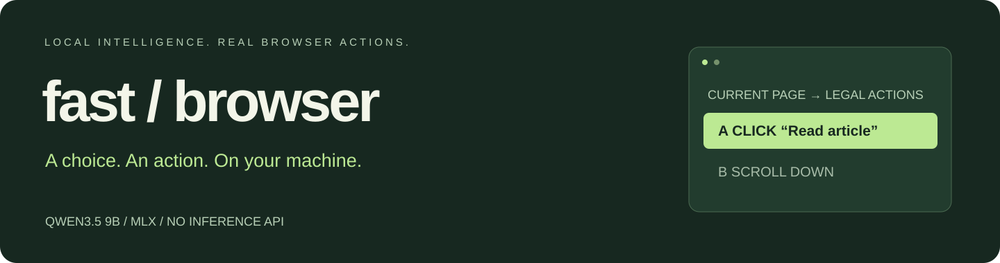
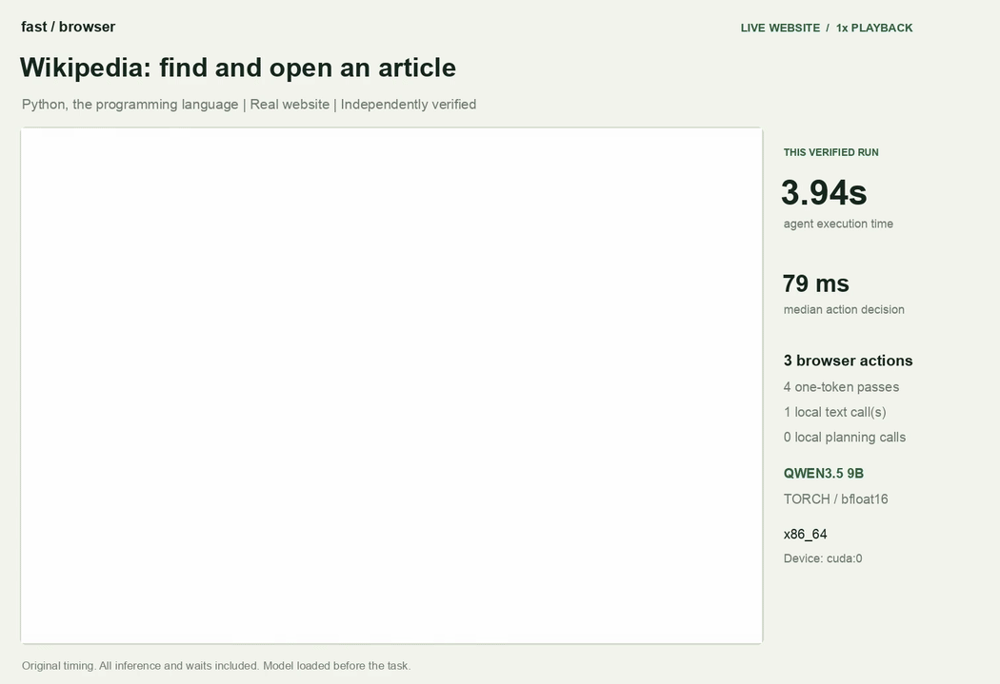
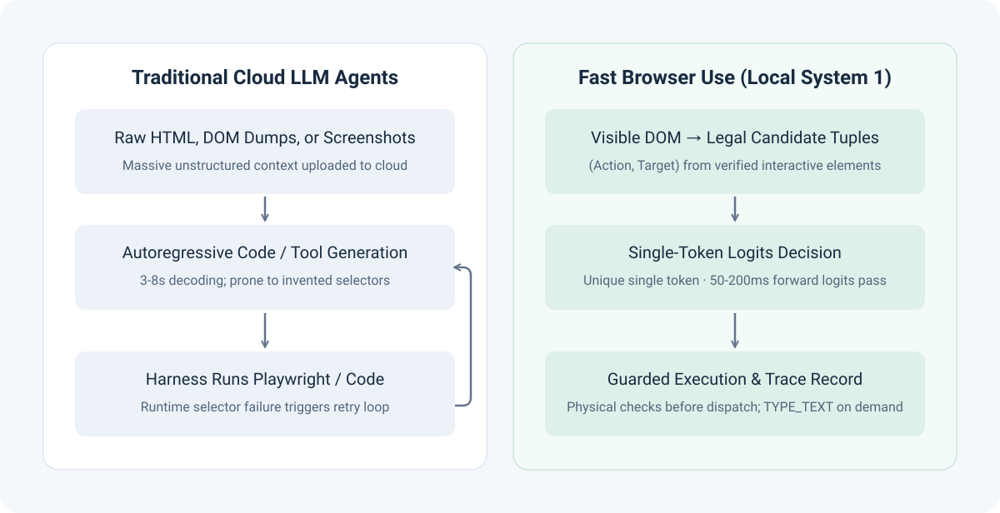
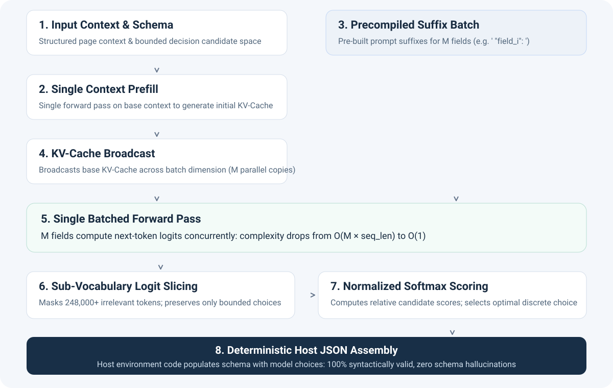
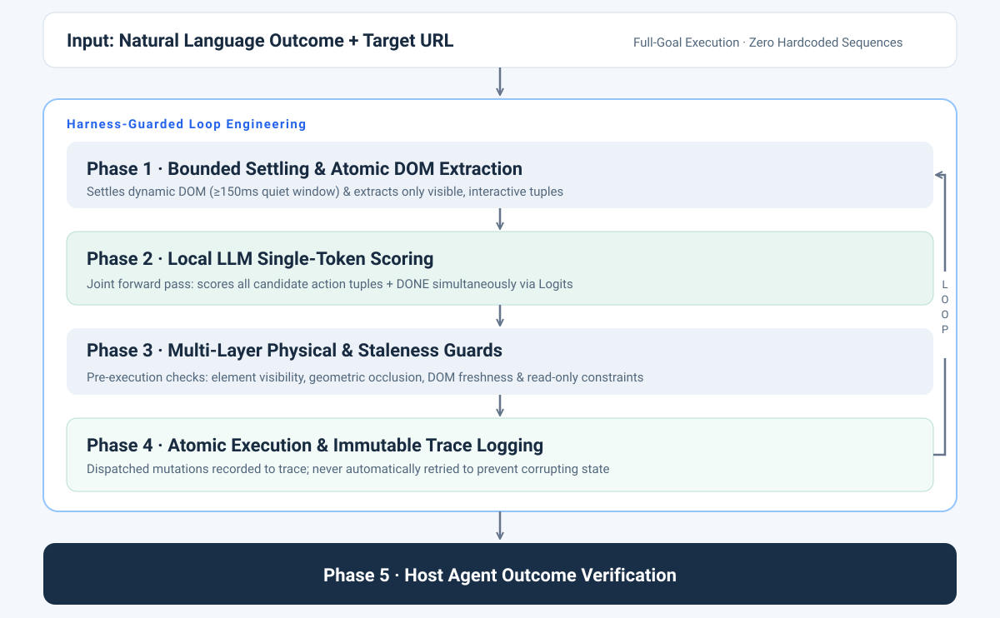

<div align="center">



# Fast Browser Use

**An ultra-fast, local-first "System 1" browser automation engine & Agent Skill for Claude Code, Codex, and Cursor.**  
*Powered by the LiquidAI d1-3B decision model via llama.cpp (100% CPU, zero GPU required). Zero cloud inference, second-level reflexes, zero selector hallucinations.*

[](LICENSE)
[](https://www.python.org/downloads/)
[](#linux--windows--gpu-pytorch)
[](https://huggingface.co/LiquidAI/d1-3B-GGUF)
[-orange.svg)](#-local-first-architecture)
[](skills/fast-browser-use/SKILL.md)

[简体中文（旗舰版）](README.md) · [English full docs](README_EN.md) · [Quickstart](#-quickstart) · [Architecture & Deep Dive](#-architecture--deep-dive) · [Benchmarks](#-benchmarks--measurements) · [Agent Skill Setup](#-agent-skill-setup) · [Python API](#-python-api)

</div>

---

<div align="center">
<a href="docs/qwen9b-demo.mp4"></a>

**[Recording preview (1× original playback)](docs/qwen9b-demo.mp4)** · **[Measurement Telemetry (JSON)](docs/qwen9b-demo-measurement.json)** · **[Performance Benchmarks](docs/performance.md)**
</div>

> **Open-Source Reverse Engineering of Jev · Pure Local Browser-Use Agent Skill**  
> Fast Browser Use reproduces Jev's System 1 discrete decision paradigm using the open-source decision model **LiquidAI d1-3B** (llama.cpp, CPU-only), grounded in real-world browser automation. By mapping visible interactive elements to named candidate codes and scoring them in a single forward pass through d1's native decision head, it structurally eliminates selector hallucinations—packaged as an out-of-the-box agent skill for 100% local, offline execution.

---

## 💡 Background: Open-Source Reverse Engineering of Jev for Browser Use

In mid-September 2026, TypeSafe AI announced **Jev** (co-founded by ex-OpenAI researcher Diogo Almeida), sparking widespread discussion across the AI developer community:

> *"Why do we default to forcing massive 100B+ parameter LLMs to decode tokens one-by-one for bounded automated actions—enduring multi-second latencies and frequent hallucinations—when most software decisions are deterministic?"*

TypeSafe AI framed the paradigm around **System 1 (fast, calibrated discrete decisions)** vs. **System 2 (slow, deliberative planning)**. By training models via RLCD (Reinforcement Learning for Calibrated Decisions) to directly score bounded, typed decision spaces instead of generating free-form text, Jev demonstrated decision speeds 20–200× faster than traditional LLMs.

Currently, Jev is provided as a cloud API service without publicly available model weights or internal implementation details. While early community projects such as [`jev-ultrafast`](https://github.com/browser-use/jev-ultrafast) showcased the speed potential by connecting to this cloud endpoint, **Fast Browser Use** explores bringing this decision paradigm fully onto local devices using open-source decision models—enabling a 100% offline, private, and zero-cloud-cost experience.

### Bringing the Paradigm 100% On-Device with the d1 Decision Model

**Fast Browser Use** is an open-source reverse engineering and local reproduction of Jev's core decision mechanics, purpose-built for the demanding domain of **browser automation (`browser-use`)**.

By analyzing Jev's documented interface paradigms and evaluation logic, as well as drawing inspiration from open-source projects, we decoupled bounded categorical decisions from slow autoregressive text generation and ported the architecture to run 100% locally on **CPU through llama.cpp** using the **LiquidAI d1-3B** decision model:

- **From Code Generation to Bounded Categorical Choice**: Traditional browser agents ask an LLM to generate raw Playwright scripts or CSS selectors, frequently causing "selector hallucinations" on dynamic pages. Fast Browser Use scans the rendered DOM tree, extracts only visible, interactable elements, and formats them into discrete candidate tuples `(CLICK, btn_7)`. The model selects exclusively from objectively existing elements—eliminating selector hallucinations by design.
- **Single-Token Logits Scoring ($O(1)$ Reflexes)**: Legal candidate actions are dynamically mapped to single discrete tokens in the vocabulary (`A`, `B`, `C`...). With a single forward pass, the engine evaluates normalized Softmax probabilities over candidate logits in **seconds (single forward pass)**, skipping the multi-second autoregressive text decoding loop entirely.
- **Decoupled Action & Generation**: Structural page actions (click, select, scroll) use discrete logits scoring; generative text completion is invoked only when typing content into fields (`TYPE_TEXT`).
- **100% Offline & Private**: Zero cloud API calls, zero telemetry, and zero subscription costs. The entire inference loop runs on your machine through MLX or PyTorch.

---

## 📊 Comparison: Cloud Agents vs. Fast Browser Use

| Dimension | Traditional Cloud Multimodal Agents | Fast Browser Use (Local System 1) |
| :--- | :--- | :--- |
| **Inference Location** | Cloud APIs (OpenAI, Anthropic, etc.) | **100% Local** (MLX or PyTorch CUDA / CPU) |
| **Step Latency** | 3,000 – 8,000 ms (Network + Decoding) | **Second-level** (Pure Logits Forward Pass) |
| **Decision Mechanism** | Autoregressive text/JSON generation | **Discrete candidate selection** (Single-Token) |
| **Selector Reliability** | Prone to invented CSS/XPath selectors | **Zero Hallucination** (Derived from visible DOM) |
| **Syntax Validity** | Subject to broken JSON, missing quotes | **100% Valid Syntax** (Deterministic host assembly) |
| **Data Privacy** | Full pages/screenshots transmitted to cloud | **100% Air-Gapped**, inference data stays on your machine |
| **Inference Cost** | Pay per token / per screenshot | **$0.00** (Free, on-device compute) |
| **Host Integration** | Standalone monolithic agent | **Standard Agent Skill** for Claude Code & Codex |

---

## 🧠 System 1 vs. System 2: Division of Labor

Fast Browser Use does not aim to replace macro-reasoning LLMs. Instead, it provides the missing **"System 1" (muscle memory & fast reflexes)** to complement **"System 2" (slow deliberate reasoning)**:



- **System 2 (Host Brain: Claude Code, Codex, Cursor, Antigravity)**:  
  Handles high-level user intent, multi-file code analysis, macro planning, and independent outcome verification.
- **System 1 (Local Engine: Fast Browser Use)**:  
  Handles high-frequency DOM sensing, micro-action selection, bounded waiting, and atomic page interactions.
- **Independent Audit**:  
  Upon completion, Fast Browser Use returns an immutable execution trace. The host agent independently verifies the resulting page state against ground truth before proceeding.

---

## 🔬 Architecture & Deep Dive

How does Fast Browser Use achieve extreme speed without closed-source weights? By transforming open-ended text generation into a **bounded categorical decision problem**:



### 1. Structurally Eliminating Selector Hallucinations
A lightweight in-page scanner inspects the rendered layout tree, extracting only **currently visible, interactable** elements. These are formatted into discrete candidate tuples:
```python
("CLICK", "btn_search")
("SELECT", "opt_timezone_sg")
("TYPE_TEXT", "input_query")
("DONE", "task_completed")
```
The model selects an action from this finite set. Because the model never writes selectors or Playwright code, selector hallucinations and syntax errors are mathematically impossible.

### 2. Single-Token Logits Scoring
Each legal candidate action is dynamically mapped to a unique single token in the tokenizer vocabulary (`A`, `B`, `C`...).  
Rather than generating text, the engine performs **one single forward pass**, extracts the next-token logits, and evaluates normalized Softmax probabilities:
$$P(c_i \mid \text{Context}) = \frac{\exp(z_i / T)}{\sum_{j=1}^K \exp(z_j / T)}$$
This reduces scoring from an $O(\text{tokens} \times \text{layers})$ autoregressive decoding loop to an $O(1)$ logits projection completed in seconds.

### 3. Action Selection & Text Generation Decoupling
Most browser interactions (clicking buttons, expanding dropdowns, scrolling) do not require creative writing.  
Fast Browser Use decouples structural navigation from text input:
- Structural choices use **single-token discrete scoring**.
- Only when the chosen action is `TYPE_TEXT` does the model perform targeted generative inference to compose the required field text.

### 4. KV-Cache Broadcasting & Batched Evaluation
By prefilling the common page context once and broadcasting the base KV-Cache across candidate dimensions, evaluating multiple fields or candidate options is parallelized into a single batch forward pass without cascading autoregressive error.

---

## 🛡️ Guarded Loop Engineering (The Harness)

A fast model without rigorous guardrails is brittle. Fast Browser Use wraps local inference inside a robust multi-layer harness:



1. **Bounded Settling Window**: Dynamic single-page apps (SPAs) often render asynchronously. A mandatory 150ms quiet window (≥500ms on new documents, ≥300ms post-input) ensures controls are fully mounted before scoring begins.
2. **Joint Action & `DONE` Scoring**: Candidate actions and completion (`DONE`) are scored within the same forward pass, slashing per-task inference passes from 14 to 4.
3. **Pre-Execution Physical Guards**:
   - **Visibility & Occlusion**: Ensures target elements are not hidden beneath overlays, modals, or banners.
   - **DOM Freshness**: Confirms that referenced nodes have not been detached or replaced by dynamic frameworks.
   - **Read-Only Protection**: Intercepts disabled or read-only controls before mutations occur.
4. **Write-Once Trace & No Mutation Retries**: Every action is immutably recorded to the execution trace before dispatch. Dispatched mutations are **never blindly retried** to prevent duplicate form submissions or destructive side effects.
5. **Independent Outcome Verification**: The model's `DONE` output is treated as a subjective hypothesis. Automated workflows must verify success through external assertions (`--expect-url`, `--expect-title`, `--expect-text`).

---

## ⚡ Benchmarks & Measurements

All measurements below were collected on NVIDIA RTX PRO 6000 Blackwell Workstation (96 GB VRAM) with **100% local inference** (zero cloud API requests):
- **Hardware**: NVIDIA RTX PRO 6000 Blackwell Workstation (96 GB VRAM, Linux x86_64)
- **Inference Stack**: PyTorch 2.14.0 (CUDA 13.0) + Flash Linear Attention (`fla`) + `causal-conv1d` native hardware kernels
- **Evaluated Models**: `Qwen3.5-9B` (BF16) & `Qwen3.5-35B-A3B` (BF16)

### 1. Wikipedia End-to-End Live Navigation

Task: *"Find and open the Wikipedia article about Python (programming language) starting from Main_Page, strictly verifying final URL and title."*

| Run Trial | Qwen3.5-9B Task Time | Qwen3.5-35B-A3B Task Time |
| :---: | :---: | :---: |
| Trial 1 | 4.055 s | 8.221 s |
| Trial 2 | 3.935 s | 4.933 s |
| Trial 3 | 4.067 s | 4.944 s |
| **Median** | **4.055 s** | **4.944 s** |

*Task completed in 4 discrete single-token scoring steps.*

### 2. Multi-Scenario Suite Performance

| Scenario & Task | Qwen3.5-9B Task Time | Qwen3.5-35B-A3B Task Time | Actions Executed | Independent Verification |
| :--- | :---: | :---: | :---: | :--- |
| **Wikipedia Navigation** (Find & open Python article) | **4.055 s** | **4.944 s** | Search focus, fill, select result, done | Strict match on final canonical URL & page title |
| **Workspace Settings Form** (Name, timezone dropdown, toggle weekly digest) | **2.488 s** | **3.360 s** | Fill, Select, Toggle, Save | Exact match on saved confirmation notification |
| **Local Reading Room Navigation** | **0.808 s** | **1.049 s** | Search, Link Click | Exact match on target article URL and title |
| **Python.org Navigation** (Navigate to About page) | **1.789 s** | **2.120 s** | Nav menu hover & click | Exact match on target `/about/` URL |
| **Example.com → IANA Info** | **1.263 s** | **1.535 s** | Anchor detection & jump | Exact match on destination domain |

### 3. LiquidAI d1-3B + llama.cpp CPU Inference (Measured Live)

The d1 decision model runs through llama.cpp's native `/v1/systemone` endpoint (single forward pass,
zero generated tokens for choices, native yes/no head for completion checks) on **CPU only**.
Measured on a constrained 2-vCPU / 4 GB cloud sandbox with headless Chromium:

| Scenario & Task | Result | Actions | Assertions |
| :--- | :---: | :--- | :--- |
| Example.com → open IANA example-domains page | **PASS** | Scroll, Click `Learn more`, auto-DONE | Exact final URL + title |
| Workspace settings form (name, timezone, digest, save) | **PASS** | Fill `Orchard`, Select `Asia/Singapore`, Toggle digest, Save | Title + 3 text checks |
| Multi-article research fixture | **FAIL** | Wandering clicks (low confidence discrimination) | Step budget reached |

Notes: decision confidence peaked at 0.90 for text extraction and 0.97 for the save action; per-step
latency was ~15–23 s on 2 vCPU (prefill-dominated) and scales down roughly linearly with core count —
expect 2–6 s/step on an 8-core desktop. The d1 yes/no (`noul`) completion head proved markedly better
calibrated than A/B choice prompting for `DONE` detection and is used by default.

---

## 🚀 Quickstart

### Prerequisites
- **System**: Linux, Windows or macOS; Python 3.12+, [uv](https://docs.astral.sh/uv/getting-started/installation/)
- **Optional**: Node.js / npm (for `npx skills` installation)
- **Hardware**: Any modern multi-core x86_64/ARM CPU (4 GB+ RAM) — **no GPU required**. The d1-3B decision model runs on llama.cpp CPU inference.

Fast Browser Use runs 100% locally with zero cloud API calls. Recommended configurations:

<table>
  <thead>
    <tr>
      <th align="center">Platform / Device</th>
      <th align="center">Recommended Backend</th>
      <th align="center">Recommended Model</th>
      <th align="center">Minimum Memory</th>
      <th align="left">Peak Runtime Memory / VRAM</th>
      <th align="left">Recommended Hardware</th>
    </tr>
  </thead>
  <tbody>
    <tr>
      <td rowspan="3" align="center"><strong>Any CPU<br>(Linux / Windows / macOS)</strong></td>
      <td rowspan="3" align="center"><strong>llama.cpp</strong><br><code>(FBU_BACKEND=llamacpp)</code><br><em>default</em></td>
      <td align="center"><code>d1-3B Q4_K_M</code></td>
      <td align="center"><strong>4 GB</strong></td>
      <td>~2 – 2.5 GB RAM</td>
      <td>4+ core desktop / laptop</td>
    </tr>
    <tr>
      <td align="center"><code>d1-3B Q8_0</code></td>
      <td align="center"><strong>6 GB</strong></td>
      <td>~3 – 3.5 GB RAM</td>
      <td>8+ core desktop</td>
    </tr>
    <tr>
      <td align="center"><code>d1-3B BF16</code></td>
      <td align="center"><strong>10 GB</strong></td>
      <td>~7 GB RAM</td>
      <td>16+ core workstation</td>
    </tr>
    <tr>
      <td align="center"><strong>Apple Silicon</strong></td>
      <td align="center"><strong>llama.cpp / MLX</strong></td>
      <td align="center"><code>d1-3B GGUF / MLX</code></td>
      <td align="center"><strong>8 GB</strong></td>
      <td>~2.5 GB unified memory</td>
      <td>M1 / M2 / M3 / M4</td>
    </tr>
    <tr>
      <td align="center"><strong>NVIDIA GPU (legacy path)</strong></td>
      <td align="center"><strong>PyTorch CUDA</strong><br><code>(FBU_BACKEND=torch)</code></td>
      <td align="center"><code>Qwen3.5-9B BF16</code></td>
      <td align="center"><strong>24 GB VRAM</strong></td>
      <td>~20 – 22 GB VRAM</td>
      <td>RTX 3090 / 4090 / A5000</td>
    </tr>
  </tbody>
</table>

### ⚡ One-Command Deploy (llama.cpp + d1-3B)

Use the bundled deploy script for a fully automated setup (builds llama.cpp, downloads d1-3B GGUF,
installs Chromium and runs a live browser verification):

```bash
git clone https://github.com/APUS-AI-Lab/fast-browser-use.git
cd fast-browser-use
bash deploy.sh            # add --with-deps on bare Linux to install browser system libraries
```

Manual equivalent:

```bash
# 1. Install the CLI in an isolated Python environment
uv sync --python 3.12

# 2. Install matching Playwright Chromium
uv run fbu install-browser

# 3. Download d1-3B GGUF weights (~1.7 GB; ModelScope mirror by default, or --source huggingface)
uv run fbu download

# 4. Build llama.cpp once (cmake + C compiler required)
git clone --depth 1 https://github.com/ggml-org/llama.cpp.git ../llama.cpp
cmake -B ../llama.cpp/build -S ../llama.cpp -DGGML_NATIVE=ON -DLLAMA_CURL=OFF
cmake --build ../llama.cpp/build --config Release -j"$(nproc)" --target llama-server

# 5. Run a live browser task — fbu auto-starts llama-server with the d1 weights on first use
FBU_MODEL=$PWD/models/d1-3B-Q4_K_M.gguf FBU_LLAMACPP_BIN=$PWD/../llama.cpp/build/bin/llama-server \
  uv run fbu run https://example.com \
  --goal 'Open the "More information" link so the IANA example-domains page is shown.' \
  --expect-url 'https://www.iana.org/help/example-domains'
```
*(If you already have the d1 GGUF, set `FBU_MODEL=/path/to/d1-3B-Q4_K_M.gguf` to skip downloading.)*

---

### 📦 Agent Skill Setup (Claude Code / Codex / Cursor)

Fast Browser Use is packaged as a standard [Agent Skill](https://github.com/vercel-labs/skills).

#### Step 1: Register the Skill
```bash
# Register globally for Claude Code and Codex (-g = global across all projects)
npx skills add APUS-AI-Lab/fast-browser-use --skill fast-browser-use -a claude-code -a codex -g -y
```

#### Step 2: Install Local Runtime and Download Model Weights

All platforms (llama.cpp CPU inference with d1-3B):
```bash
# 1. Install the CLI in an isolated Python environment
uv tool install --python 3.12 "git+https://github.com/APUS-AI-Lab/fast-browser-use.git"

# 2. Install matching Playwright Chromium
fbu install-browser

# 3. Download the d1-3B GGUF weights (~1.7 GB, ModelScope mirror by default)
fbu download

# 4. Point fbu at a llama-server binary (build once, see deploy.sh) and the weights
export FBU_LLAMACPP_BIN=/path/to/llama-server
export FBU_MODEL=$HOME/.cache/fast-browser-use/d1-3B-Q4_K_M.gguf
```
*(The first `fbu run` auto-starts `llama-server` in the background; subsequent runs reuse it.)*

### Interactive Chat (fbu chat) — Claude-Code-style TUI

After deploying, run `fbu chat` (or `.
bu.bat chat`) for an interactive loop
with a **visible** browser (add `--headless` to hide it). Type a task in plain
language, watch the steps render live: under each `⏺ step · action ·
confidence · time` line a dim transcript line shows how d1-3B decided
(top candidates with probabilities, decision/execution time split, prompt
tokens, scoring passes) — detailed without flooding; toggle with `/decide`.
Remote-LLM answers render as markdown. The session remembers
previous turns and every remote-LLM call receives that history, so follow-ups
like "continue the previous task" or "它是什么域名" just work.

```text
/open <url>    navigate without running a task
/history       show the session turns the LLM can see
/decide        toggle per-step d1 decision details (or FBU_STEP_DETAIL=0)
/clear         forget the session history
/llm           show remote-LLM status     /help   all commands
/exit          quit (Ctrl+C / Ctrl+D also work)
```

`FBU_ASK_LLM_LIMIT` (default 2) caps consecutive LLM consultations with no
browser action in between, so the agent cannot get stuck chatting instead of
acting.

### Windows One-Click Deploy (deploy.bat)

No compiler or CMake needed on Windows. Double-click `deploy.bat`: it creates the
virtualenv, installs dependencies and Playwright Chromium, verifies the model
weights, downloads a prebuilt llama.cpp Windows CPU build, and finishes with a
live real-browser verification task.

```text
1. Double-click deploy.bat  (or run .\deploy.bat in the project folder)
2. Weights live at  models\d1-3B-Q4_K_M.gguf
   - Already downloaded the GGUF? Just copy it into the project's models\ folder.
   - Missing? The script auto-downloads it from ModelScope (~1.7 GB).
3. Run tasks from a terminal in the project folder:
   fbu run https://example.com --goal "Open the More information link"
```

Model search order: `FBU_MODEL` → `models\` in the current/project directory →
`~/.cache/fast-browser-use`. llama-server detection order: `FBU_LLAMACPP_BIN` →
PATH → `tools\llama.cpp\llama-server.exe` → `build\bin\llama-server.exe`. If the
GitHub download fails, grab `llama-*-bin-win-cpu-x64.zip` from
[llama.cpp releases](https://github.com/ggml-org/llama.cpp/releases/latest) and drop
`llama-server.exe` into `tools\llama.cpp\`.

### 🤝 Remote-LLM Collaboration (ASK_LLM, decided by the model itself)

Beyond the local d1-3B, you can attach a larger remote LLM as an "advisor"
(default: ModelScope API-Inference, `deepseek-ai/DeepSeek-V4.1-Flash-1017`, low
thinking). The key design: **ASK_LLM is a first-class candidate in d1's scoring
space**, so the decision model itself decides — in the same single forward pass
it uses for page actions — when remote help is worth it. No hard-coded triggers:

- QA tasks ("what is this page about?") → d1 picks ASK_LLM; the LLM answers from
  the visible page text; answers land in the trace `answers` and the CLI output;
- summary tasks → the final step picks ASK_LLM; the result is recorded as `summary`;
- low confidence (< `FBU_LLM_CONFIDENCE`) → automatic second opinion from the LLM;
- stuck runs (3 no-change steps) → the LLM diagnoses and proposes a revised
  subgoal; the run resumes with the LLM proposing and d1 deciding;
- a goal that says "don't use the LLM" → d1 simply stops scoring ASK_LLM highly.

Configuration (env vars or a project-root `.env`, auto-loaded by `fbu`):

| Variable | Default | Meaning |
| :--- | :--- | :--- |
| `FBU_LLM_API_BASE` | `https://api-inference.modelscope.cn/v1` | OpenAI-compatible endpoint |
| `FBU_LLM_MODEL` | `deepseek-ai/DeepSeek-V4.1-Flash-1017` | Advisor model |
| `FBU_LLM_API_KEY` | built-in default key | Set empty `""` to disable remote calls |
| `FBU_LLM_ESCALATION` | `auto` | `auto` = rules above; `off` = 100% local |
| `FBU_LLM_CONFIDENCE` | `auto` (0.55) | Second-opinion threshold |
| `FBU_LLM_TIMEOUT` / `FBU_LLM_THINKING` / `FBU_LLM_RESCUE_LIMIT` | 60 / 0 / 2 | Timeout / thinking mode / rescue cap |
| `FBU_ASK_LLM_LIMIT` | 2 | Max consecutive ASK_LLM consults with no browser action in between（连续 LLM 咨询上限，防止空转） |

Verified on example.com: for a summary task d1 picked ASK_LLM with 0.94/0.96
confidence and produced a correct page summary; the navigation task (click
"More information" → IANA) passed its assertions with zero LLM calls; with
escalation forced (`FBU_LLM_CONFIDENCE=0.99`) every step was double-checked and
the task still passed. The remote LLM can never override a decision to BLOCKED —
the right to stop stays with the local decision model.

#### Step 3: Invoke from Your Host Agent
Launch a new agent session in any project:

**In Claude Code:**
```text
/fast-browser-use Open https://en.wikipedia.org/wiki/Main_Page, find the Python programming language article, and verify the final URL and title.
```

**In Codex:**
```text
$fast-browser-use Open https://en.wikipedia.org/wiki/Main_Page, find the Python programming language article, and verify the final URL and title.
```

---

### Linux / Windows / GPU (PyTorch)

The `torch` extra adds PyTorch, Transformers and Accelerate. `FBU_BACKEND=auto` selects MLX on
Apple Silicon and PyTorch elsewhere; `--backend torch` selects PyTorch explicitly.

```bash
# From a checkout in a Linux GPU environment
uv sync --locked --extra torch --python 3.12
uv run fbu install-browser --with-deps

# Download 9B weights (default) or 35B-A3B weights
uv run fbu download --backend torch --model 9b
uv run fbu download --backend torch --model 35b

# Compare and record 9B vs 35B-A3B tasks
uv run fbu record --backend torch --device cuda --model 9b --scenario wikipedia --output artifacts/wikipedia_9b
uv run fbu record --backend torch --device cuda --model 35b --scenario wikipedia --output artifacts/wikipedia_35b
```

`--with-deps` installs Chromium's Linux system libraries and may require root/sudo. Neither a desktop,
`DISPLAY`, Xvfb, VNC nor the inspector is needed. All recordings explicitly use headless Chromium.
The original `browser.webm`, screenshots, trace and independent verification are saved on the server.

For a globally available CLI:

```bash
uv tool install --python 3.12 'fast-browser-use[torch] @ git+https://github.com/APUS-AI-Lab/fast-browser-use.git'
fbu install-browser --with-deps  # On Windows/macOS, omit --with-deps
fbu download --backend torch --model 9b
```

PyTorch supports selecting between the pinned original [Qwen/Qwen3.5-9B](https://huggingface.co/Qwen/Qwen3.5-9B)
and the MoE [Qwen/Qwen3.5-35B-A3B](https://huggingface.co/Qwen/Qwen3.5-35B-A3B) checkpoints
through the [Transformers text-only loader](https://huggingface.co/docs/transformers/model_doc/qwen3_5).
Select via `--model 9b` / `--model 35b` or `FBU_MODEL=35b` (defaults to `9b`).
MLX 4-bit files cannot be reused by PyTorch. When switching backends, remove an old `FBU_MODEL`
override or point it to matching local weights. Downloads use Hugging Face; the existing ModelScope
mirror is available for MLX only. After downloading, `HF_HUB_OFFLINE=1` prevents further Hub access;
browsing live websites still requires network access.

| Setting | Default / supported values |
| :--- | :--- |
| `FBU_BACKEND` / `--backend` | `auto` → `llamacpp` (default stack), `llamacpp`, `mlx` (macOS), `torch` |
| `FBU_LLAMACPP_URL` | llama.cpp server endpoint, default `http://127.0.0.1:8765`; auto-starts on first use |
| `FBU_LLAMACPP_BIN` | Path to a `llama-server` binary (auto-detected from PATH or a sibling build) |
| `FBU_LLAMACPP_CACHE_REUSE` / `FBU_LLAMACPP_CACHE_RAM` | 256 / 1024 | llama-server KV-prefix cache knobs (benefit the plan/field-text chat endpoint; LFM2 decision requests cannot reuse KV across calls — llama.cpp limitation) |
| `FBU_LLAMACPP_CTX` | 16384 | llama-server context window; overflowing requests are retried once with compacted state and server error details are surfaced verbatim |
| `FBU_PLAN` | auto | auto = decompose multi-step goals into a subgoal checklist; 1 = always; 0 = never |
| `FBU_MAX_CANDIDATES` | 28 | Cap on the visible candidate table: on huge pages (bing) goal-irrelevant nav links are dropped first (fills/buttons/keyword matches survive), sharpening confidence and cutting CPU scoring time |
| `FBU_NO_VALUE_LIMIT` | 3 | Stop after N consecutive failures to determine a fill value; model refusals ("None of the above…") are never typed into real fields |
| `FBU_MAX_STEPS` | 60 | Max browser actions per task |
| `FBU_MODEL` / `--model` | d1 GGUF file (`d1-3B-Q4_K_M.gguf` default) or a local model directory |

CUDA runs on one selected GPU; `cuda:N` uses the index visible to PyTorch (including
`CUDA_VISIBLE_DEVICES`). Install a [PyTorch build matching your GPU driver](https://pytorch.org/get-started/locally/)
if the installed build does not expose CUDA. On Windows, the same CLI works from PowerShell;
use `$env:FBU_BACKEND='torch'` when setting environment variables.

### 💻 Standalone CLI Usage & CI Assertions

Run tasks directly from the command line with external outcome verifiers:

```bash
# Generic web task with strict assertions
fbu run https://en.wikipedia.org/wiki/Main_Page \
  --goal 'Find and open the Wikipedia article about Python, the programming language.' \
  --expect-url 'https://en.wikipedia.org/wiki/Python_(programming_language)' \
  --expect-title 'Python (programming language) - Wikipedia' \
  --trace artifacts/wikipedia_trace.json
```

```bash
# Complex form filling with multiple expected text checks
fbu run 'https://target.example/settings' \
  --goal 'Save workspace preferences with timezone Asia/Singapore and weekly digest enabled.' \
  --expect-title 'Preferences saved' \
  --expect-text 'Timezone: Asia/Singapore.' \
  --expect-text 'Weekly digest: enabled.' \
  --trace artifacts/preferences.json
```

- `--expect-url` & `--expect-title`: Exact equality matching on final page state.
- `--expect-text`: Substring check on page text content (repeatable).
- Assertions read a fresh post-execution DOM state, are never passed into the model prompt, and fail the command if unmet.

<details>
<summary>Install from Local Checkout / Without Node.js</summary>

```bash
git clone https://github.com/APUS-AI-Lab/fast-browser-use.git
cd fast-browser-use
uv tool install --python 3.12 .
fbu install-browser
fbu download
```

Manual symlinks without Node.js:
```bash
mkdir -p "$HOME/.claude/skills" "$HOME/.agents/skills"
ln -s "$PWD/skills/fast-browser-use" "$HOME/.claude/skills/fast-browser-use"
ln -s "$PWD/skills/fast-browser-use" "$HOME/.agents/skills/fast-browser-use"
```

</details>

<details>
<summary>Hugging Face Model Download & Offline Mode</summary>

Download pre-quantized 4-bit weights directly from Hugging Face:
```bash
# Download d1-3B GGUF weights to a custom directory
fbu download --output models
FBU_MODEL=models/d1-3B-Q4_K_M.gguf fbu run https://www.python.org/ \
  --goal 'Open the About Python page.' --expect-url 'https://www.python.org/about/'
```

After downloading, enable offline execution:
```bash
export HF_HUB_OFFLINE=1
```

</details>

---

## 🐍 Python API

Integrate Fast Browser Use directly into your Python automation workflows:

```python
from fast_browser_use import Agent
from fast_browser_use.model import get_model

# Warm up weights once
get_model()

# Execute task with fine-grained state streaming
with Agent("https://example.com", "Open the More information link.") as agent:
    for state in agent.run():
        print(f"[{state['elapsed_ms']}ms] Step status: {state['status']}")
        if "action" in state:
            print(f"  Action: {state['action']}")
```

---

## 🎥 Recording & Reproducing Demos

Recordings use Playwright Chromium video capture in headless mode, even if `FBU_HEADLESS=0`
is set for interactive debugging. No desktop recorder is used. Generate auditable videos with
labeled playback speeds (preview rendering requires `ffmpeg`/`ffprobe`; raw recording does not):

```bash
# Headless recording: saves 1x original video + telemetry, including inference/waits
uv run fbu record --scenario wikipedia
uv run fbu record --scenario wikipedia --model 35b

# Render labeled preview (target <= 10s with preserved original)
uv run python scripts/render_demo.py artifacts/recordings/<timestamp> --max-seconds 10
```

---

## 🛠️ Verification & Development

Run the full local test and guard suite:

```bash
uv run ruff check .
uv run pytest
# Also run tiny random-model PyTorch tests without downloading pretrained weights:
uv run --extra torch pytest tests/test_torch_backend.py
node --check fast_browser_use/static/app.js
node --check fast_browser_use/snapshot.js
uv run python scripts/check_guards.py
uv build
```

---

## 📄 License & Attribution

This project is licensed under the [MIT License](LICENSE).  
Inspired by [Jev Ultrafast](https://github.com/browser-use/jev-ultrafast). Upstream MIT attribution and notices are preserved in [NOTICE](NOTICE). This project also draws inspiration and ideas from [openjev](https://github.com/TheoLeeCJ/openjev) and [Qwen-2.5-1B-RLCD](https://huggingface.co/harshatheg/Qwen-2.5-1B-RLCD).

---

<div align="center">
<b>Fast Browser Use</b> · Built for the next generation of autonomous local-first agents.
</div>
